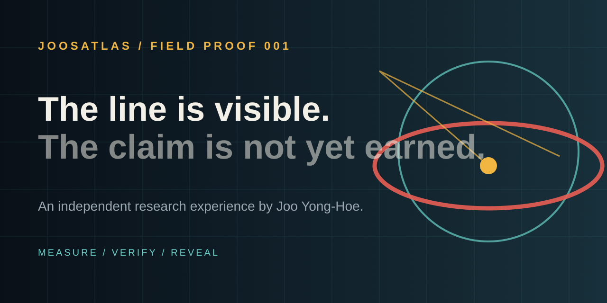

# JoosAtlas

**The line is visible. The claim is not yet earned.**

JoosAtlas is an independent research experience created by **Joo Yong-Hoe**, exploring how surveying, photogrammetry, computer vision, and spatial evidence can be connected into traceable and auditable measurement.

[Open the public experience →](https://daejinpipero-gaja.github.io/JoosAtlas/)

## About Joo Yong-Hoe

- **Research** — Ph.D. Candidate, Yonsei University · Geospatial Information & Remote Sensing Laboratory (GRS Lab)
- **Industry** — President, Daejin Pipe Co., Ltd.
- **Community** — President, ACERS

His work connects rigorous spatial measurement with real operating environments, turning research questions into auditable methods, clear visual explanations, and deployable tools.

## Field Proof / 001

This public-safe research teaser communicates:

- the difference between visual appearance and measurement evidence;
- role separation across datum, image, reference, and audit;
- the conditions required before a spatial claim is permitted;
- failure as a first-class research outcome.

## Disclosure boundary

| Item | Status |
|---|---|
| Research question | Released |
| Qualitative findings | Released |
| Researcher profile | Released |
| Exact method and equations | Withheld |
| Experimental geometry | Withheld |
| Numerical results and data | Withheld |
| Paper | Under review |

This repository does **not** contain raw data, unpublished numerical results, equipment settings, implementation details, or reviewer correspondence.

## Rights

Website content and visual assets are © 2026 Joo Yong-Hoe. All rights reserved unless explicitly stated otherwise.

> Affiliations are provided for biographical context. JoosAtlas is an independent personal research platform and does not represent the official views of the affiliated organizations.
